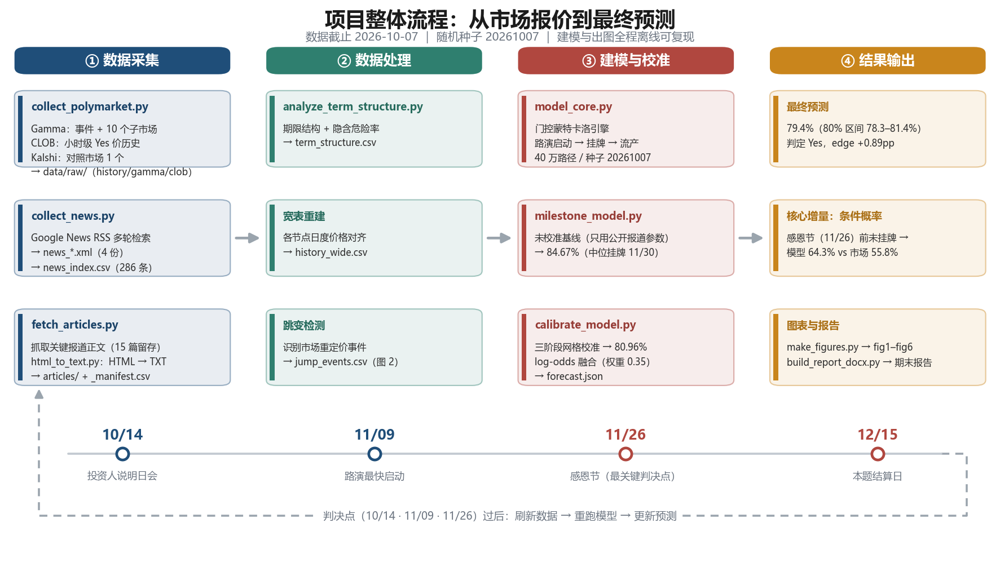

# 认知智能前沿技术与实践 · 期末项目

**选题类别**：真实事件预测
**预测题目**：Anthropic 是否会在 2026 年 12 月 15 日前正式 IPO？
**预测标的**：Polymarket 事件 `anthropic-ipo-by` / 子市场 `december-15-2026`
**数据截止**：2026-10-07

---

## 一句话结论

门控蒙特卡洛模型给出 **P(12/15 前挂牌) = 80.96%**，市场报价 78.5%；
log-odds 融合（模型权重 0.35）后 **最终预测 79.4%（80% 区间 78.3%–81.4%），判定 Yes**，
edge +0.89pp。核心增量不是点位，而是市场无法提供的**条件概率**：
若感恩节前未挂牌，则 12/15 前挂牌的条件概率为 **模型 64.3% vs 市场 55.8%**。

## 项目流程



**① 数据采集**（Polymarket / Kalshi / 新闻正文）→ **② 数据处理**（期限结构、
宽表历史、跳变检测）→ **③ 建模与校准**（门控蒙特卡洛 + 三阶段网格校准 +
与市场 log-odds 融合）→ **④ 结果输出**（`forecast.json`、fig1–fig6、期末报告）。
底部三个判决点过后刷新数据并重跑模型，即可更新预测。

## 每一步的原理

上面这张图里每一步**为什么这样做**（原理、与替代方案的对比、公式、产物）都写在
[`docs/项目原理说明.md`](docs/项目原理说明.md)。它与流程图**编号一一对应**：

| 阶段 | 步骤 | 原理内核 | 一句话结论 |
|---|---|---|---|
| ① 数据采集 | 1.1 市场数据 | 无套利 ⇒ 二值合约价格 = 概率 | 多节点拼出 CDF，流动性决定报价可信度 |
| | 1.2 新闻索引 | 要「事件证据」，不要「舆情」 | 四组查询词覆盖流程 / 时程 / 文书 / 规模 |
| | 1.3 正文抽取 | 去 DOM 噪声保留可见文本 | 证据纪律：至少两家来源交叉印证 |
| ② 数据处理 | 2.1 期限结构 + 危险率 | 按结算日排序才是 CDF | 反演隐含危险率，**用数据否定无记忆假设** |
| | 2.2 宽表重建 | 统一 event-time 网格 | 消除「非同步观测」造成的伪差异 |
| | 2.3 跳变检测 | 价格跳变 = 信息到达 | 验证「市场按里程碑门重定价」 |
| ③ 建模与校准 | 3.1 门控蒙特卡洛 | 分阶段流程替代无记忆假设 | 三点估计 + 日历约束 + 吸收态 + MC |
| | 3.2 未校准基线 | 先注册参数，后看市场 | 量化先验偏差（+6.17pp、中位偏晚 4 天） |
| | 3.3 校准与融合 | 校准 ≠ 拟合，log-odds 融合 | 参数必须能被公开证据解释；w=0.35 偏向市场 |
| ④ 结果输出 | 4.1 最终预测 | 单一事实源 `forecast.json` | 点估计 + 区间 + 判定三件套 |
| | 4.2 条件概率 | 边缘相同 ≠ 条件结构相同 | 模型 64.3% vs 市场 55.8%，真正的增量 |
| | 4.3 图表与报告 | 每张图承担一个论证环节 | 图必须脚本可复现，报告单一来源渲染 |

文档末尾还有 **公式速查表**、**被淘汰方案一览**、**「数字 → 文件」追溯表**与**易错点清单**，
答辩与查错时可直接对照使用。

## 目录结构

```
├── docs/                        # 交付文档
│   ├── 项目初步方案.md            # 期中展示用：设计思想 / 算法框架 / 数据采集 / 进展
│   ├── 项目原理说明.md            # 分步原理：每步「为什么这样做」+ 公式速查 + 易错点
│   ├── 项目报告.md                # 期末报告源文件（Markdown）
│   └── 第XX小组-项目期末报告.docx   # 由 md 渲染的提交版（需改名替换 XX）
├── figures/                     # fig0 流程示意图 + fig1–fig6 结果图
├── scripts/                     # 全部源代码
├── data/
│   ├── raw/                     # 原始抓取数据（Polymarket / Kalshi / 新闻正文）
│   └── processed/               # 中间结果与最终预测（forecast.json）
├── PJ要求2026.docx               # 课程要求原文
└── 预测网站题目.docx              # 题目列表
```

## 复现（Windows / PowerShell）

```powershell
# 建模与出图只需 Python + numpy + matplotlib（数据已落盘，无需联网）
python scripts/analyze_term_structure.py
python scripts/milestone_model.py         # 未校准基线
python scripts/calibrate_model.py         # 三阶段校准 + 融合 + 情景分析
python scripts/make_figures.py            # 生成 figures/fig1–fig6
python scripts/make_pipeline_figure.py    # 生成 figures/fig0_pipeline.png 流程示意图

# 重新渲染 Word 报告（需要 python-docx）
python scripts/build_report_docx.py

# 仅在需要刷新数据时执行（需要代理访问 Polymarket / Kalshi / Google News）
python scripts/collect_polymarket.py
python scripts/collect_news.py
```

随机种子固定为 `20261007`，结果可完全复现。

## 代码模块

| 脚本 | 职责 |
|---|---|
| `polymarket_client.py` | Gamma / CLOB API 客户端 |
| `collect_polymarket.py` | 采集事件、子市场、小时级价格历史 |
| `analyze_term_structure.py` | 期限结构、宽表历史、跳变检测 |
| `collect_news.py` / `fetch_url.py` / `html_to_text.py` | 新闻检索、抓取、正文抽取 |
| `model_core.py` | **门控蒙特卡洛引擎**（Params / simulate / SimResult / blend_logodds） |
| `milestone_model.py` | 未校准基线模型 |
| `calibrate_model.py` | 三阶段网格校准 + 市场融合 + 情景分析 + 敏感性曲面 |
| `make_figures.py` | 生成报告用图 |
| `make_pipeline_figure.py` | 生成整体流程示意图 fig0（供 README / 报告使用） |
| `build_report_docx.py` | Markdown 报告 → Word 提交版 |

## 组员协作

### 第一次使用

```powershell
git clone <仓库地址>
cd Final_PJ

# 只跑建模 + 出图：数据已随仓库提供，不需要联网
python scripts/calibrate_model.py
python scripts/make_figures.py
```

只需要 `numpy` + `matplotlib` 就能复现全部结论；
`python scripts/build_report_docx.py` 额外需要 `python-docx`。

### 改动约定

| 想改什么 | 改哪里 | 注意事项 |
|---|---|---|
| 原理 / 方法论表述 | `docs/项目原理说明.md` | 与 `figures/fig0_pipeline.png` 的编号一一对应，改动时保持同步 |
| 报告文字 / 结论 | `docs/项目报告.md` | 定稿后再跑 `build_report_docx.py` 生成 Word |
| 图表 | `scripts/make_figures.py` | **不要手改 `figures/*.png`**，改脚本后重跑 |
| 模型逻辑 / 参数 | `scripts/model_core.py`、`calibrate_model.py` | 改完重跑 `calibrate_model.py`，`forecast.json` 会随之更新 |
| 原始数据 | `data/raw/` | 目录较大，动手前先 `git pull`，避免冲突 |

- 提交前先 `git status`，确认没有夹带自己电脑上的临时文件（`.gitignore` 已排除
  `__pycache__/`、Office 锁文件 `~$*.docx`、浏览器临时转储等）。
- 大文件（`data/raw/articles/*.htm`、`data/raw/clob_markets.json`）已入库，
  如非必要不要重复提交它们的改动。

## 待办

- [ ] 填入小组编号（`第XX小组` → 实际编号）与成员名单、分工
- [ ] 按 [`docs/小组分工与进度计划.md`](docs/小组分工与进度计划.md) 落实四人分工
      （数据与流水线 / 模型与校准 / 报告与图表 / 展示与交付）
- [ ] **补采 10/14 判决点数据**（当前 `forecast.json` 仍停留在 2026-10-07）
- [ ] 准备期中 / 期末展示材料
- [x] `data/raw/` 下的临时转储已在 `.gitignore` 中排除（本地文件保留，不影响复现）
- [ ] 打包提交：报告 + `第XX小组-项目源代码` 文件夹
- [ ] 2026-10-14 / 11-09 / 11-26 三个判决点后刷新数据并重跑模型
